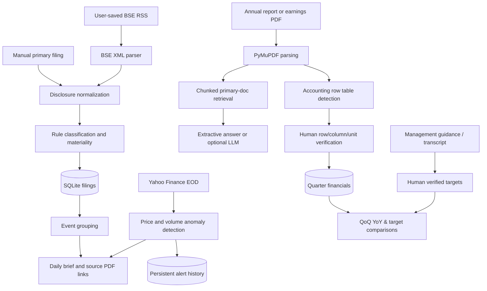

# Technical architecture — FINN release 4

## Design principles

- **Separation of concerns:** exchange adapter (`bse_import.py`); materiality (`core.py`); event de-dup/group (`grouping.py`); research (`research.py`); structured PDF candidates (`pdf_financials.py`); deterministic quarter comparisons (`financials.py`); EOD (`main.py`); persisted data (`storage.py`); digest (`briefing.py`).
- **Real-source labels:** `source`, `published`, `ticker`, `url`, and original descriptions remain available for every filing; grouping does not delete originals.
- **No unsupported claims:** PDF candidates are labelled `review_required`. Unit conversion is only offered when an amount unit is confidently detected. Unknown units are not copied as INR crore.
- **Fallbacks:** if BSE/NSE HTTP is blocked, use a user-saved official RSS file; if market data is offline, display an unavailable state; if no LLM key, use extractive citations.
- **Cache / compute:** market queries are cached 15 minutes; numerical computations are Python, not generative-model arithmetic; source texts are indexed and reused, reducing repeated model calls.
- **Calendar vs fiscal:** `2026-Q3` means July–September 2026; India's FY27 Q2 is the same calendar period. QoQ compares Q3 to Q2; YoY compares 2026-Q3 to 2025-Q3.
- **Controlled periodic checking:** optional `FINN_AUTO_POLL_MINUTES` can record EOD triggers, if the server stays up. This does not send SMS, email or device notifications.

## Known technical risks

- RSS snapshot contains numerous BSE debt/security codes for the same issuer. Only a mapped 20-company equity list is trusted in portfolio mode. Scope `all` uses a simple debt-code heuristic, which is *not* a validated master security database.
- PDF tables often contain both standalone and consolidated sections and multiple periods. Candidate columns are not automatically assigned to calendar quarter values. Human review remains necessary.
- SQLite is sufficient for one local hiring prototype but not multi-user concurrent production ingestion. `FINN_DATA_DIR` must be attached to persistent storage in deployment.
- Browsers may access exchange filing URLs that a Python backend cannot; this app does not try to bypass exchange bot restrictions.
- Optional OpenAI prompt constrains answers to retrieved company-source passages, but retrieved documents can still contain adversarial instructions; users must verify claims against original pages.
- Public write endpoints lack authentication/rate limits. Use the demo only in a controlled environment; add auth, tenant separation, request quotas and safety controls before production.

## Model usage and cost judgement

Primary extraction, categorical scoring, quarterly growth and EOD alerts are deterministic (no LLM tokens). TF-IDF search works locally with open-source libraries. Optional lower-cost synthesis occurs only when explicitly asked about a company and an API key is configured. Source citations remain visible regardless of model availability.
